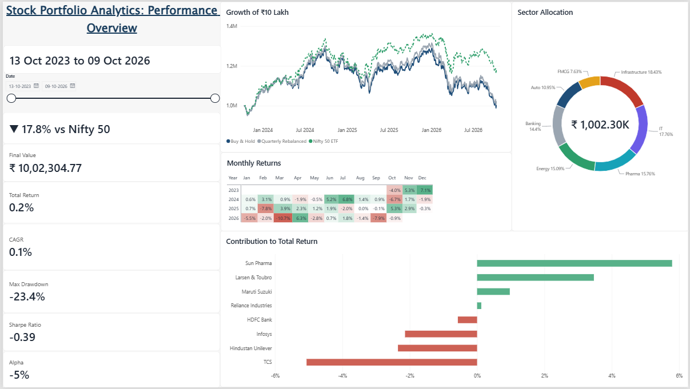
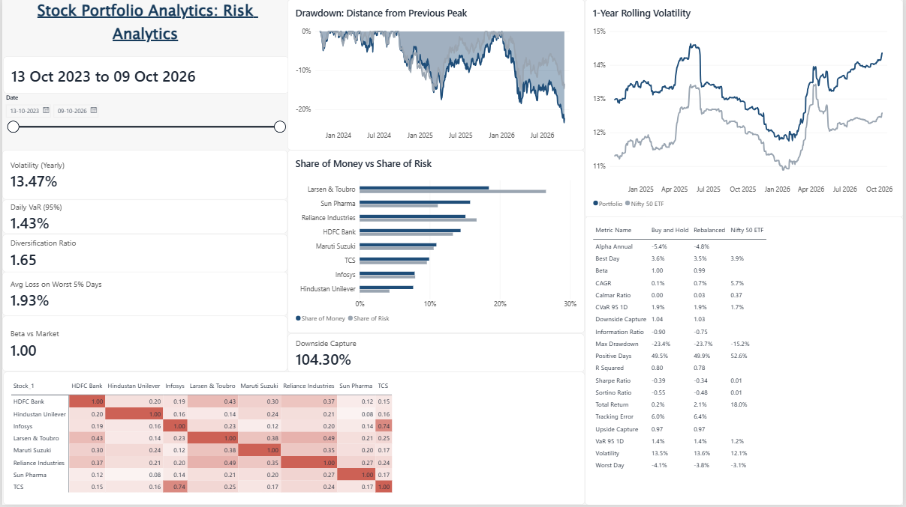
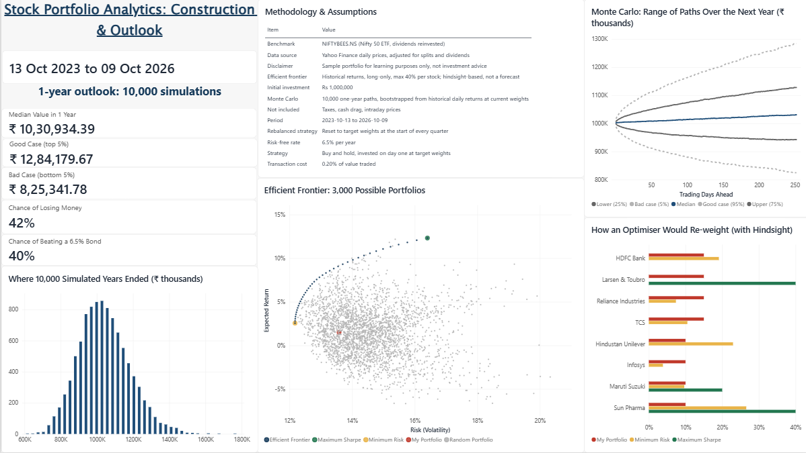

<div align="center">

# 📊 Stock Portfolio Analytics

### Performance · Risk · Portfolio Construction

*Can a diversified basket of blue-chip stocks beat the index?*<br>
*A complete portfolio analytics study built with Python and Power BI.*

<br>


<br>

[Overview](#-overview) •
[Dashboard](#-dashboard) •
[Key Findings](#-key-findings) •
[Methodology](#-methodology) •
[How to Run](#-how-to-run) •
[Limitations](#%EF%B8%8F-limitations)

</div>

<br>

> [!NOTE]
> This is a sample portfolio built for learning purposes only. Nothing in this repository is investment advice.

<br>

## 🎯 Overview

**₹10 lakh** was invested in **8 large-cap Indian stocks** for **3 years** (13 Oct 2023 to 09 Oct 2026) and compared against a **Nifty 50 ETF**.

The result was surprising: the portfolio ended almost exactly where it started, while the index fund grew by 18%. This project uses institutional-style performance, risk and portfolio construction analysis to explain **why**.

<div align="center">

| 📈 Portfolio Return | 🏦 Nifty 50 ETF Return | 📉 Max Drawdown | 🎲 Chance of Loss (Next Year) |
|:---:|:---:|:---:|:---:|
| **0.2%** | **18.0%** | **−23.4%** | **42%** |

</div>

<br>

## 🖥️ Dashboard

The Power BI report has three pages, each answering one question.

### Page 1 · Performance Overview
*How did the portfolio perform, and where did the returns come from?*



<br>

### Page 2 · Risk Analytics
*How risky was the portfolio, and where did that risk come from?*



<br>

### Page 3 · Construction & Outlook
*Could a better mix have done better, and what might happen next?*



<br>

## 🔍 Key Findings

### 1. The portfolio caught the market's falls, but not its rises

Downside capture was **104%**, while upside capture was only **97%**. On bad days the portfolio fell a little more than the market, and on good days it rose a little less. Repeated over 3 years, this small gap became a **17.8 percentage point** shortfall.

### 2. Two stocks were really one bet

TCS and Infosys had a correlation of **0.74**, the highest pair in the portfolio. The 25% allocation to IT behaved like one concentrated position, and these two stocks were the biggest drags on return. IT's share of the portfolio shrank from **25% to 17.8%**.

### 3. Eight stocks carried more risk than fifty

With a beta of **1.00**, the portfolio took on full market risk *plus* extra risk from holding only 8 companies. Volatility (**13.5% vs 12.1%**) and maximum drawdown (**−23.4% vs −15.2%**) were both worse than the index.

### 4. "Optimal" portfolios are built on hindsight

The maximum-Sharpe optimiser put **40% in Larsen & Toubro, 40% in Sun Pharma and 20% in Maruti Suzuki**, and nothing in the rest. These are exactly the three best past performers. The optimiser simply picked yesterday's winners, which is why optimising on past data often disappoints in the future.

### 5. Rebalancing helped slightly

Resetting to target weights every quarter returned **2.1% vs 0.2%** for buy-and-hold, even after a 0.2% trading cost, by regularly trimming winners and adding to laggards.

### 6. It was a tough period for everyone

Even the Nifty 50 ETF's yearly growth (**5.7%**) was below the **6.5%** government bond rate. The market as a whole struggled, and the portfolio's concentration made it worse.

<br>

### 📋 Full Scorecard

| Metric | Buy & Hold | Quarterly Rebalanced | Nifty 50 ETF |
|:---|:---:|:---:|:---:|
| Total Return | 0.2% | 2.1% | 18.0% |
| CAGR (yearly growth) | 0.1% | 0.7% | 5.7% |
| Volatility | 13.5% | 13.6% | 12.1% |
| Sharpe Ratio | −0.39 | −0.34 | 0.01 |
| Sortino Ratio | −0.55 | −0.48 | 0.01 |
| Max Drawdown | −23.4% | −23.7% | −15.2% |
| Beta | 1.00 | 0.99 | — |
| Alpha (yearly) | −5.4% | −4.8% | — |
| Downside Capture | 104% | 103% | — |
| Upside Capture | 97% | 97% | — |

### 🧩 Where the Returns Came From

| Stock | Sector | Contribution to Return |
|:---|:---|:---:|
| 🟢 Sun Pharma | Pharma | +5.8 pts |
| 🟢 Larsen & Toubro | Infrastructure | +3.5 pts |
| 🟢 Maruti Suzuki | Auto | +1.0 pts |
| 🟢 Reliance Industries | Energy | +0.1 pts |
| 🔴 HDFC Bank | Banking | −0.6 pts |
| 🔴 Infosys | IT | −2.1 pts |
| 🔴 Hindustan Unilever | FMCG | −2.4 pts |
| 🔴 TCS | IT | −5.1 pts |
| **Total** | | **+0.2 pts** |

### 🎲 One-Year Outlook (10,000 Simulations)

| Scenario | Value in 1 Year | Change |
|:---|:---:|:---:|
| Bad case (bottom 5%) | ₹8,25,340 | −17.7% |
| Median outcome | ₹10,30,930 | +2.9% |
| Good case (top 5%) | ₹12,84,180 | +28.1% |

There is a **42% chance of losing money** and only a **40% chance of beating a 6.5% government bond**. The simulation reuses the last 3 years of returns, so it means *"if the next year looks like the last three"*, not a prediction.

<br>

## 🧪 Methodology

<details>
<summary><b>Portfolio and data</b> (click to expand)</summary>

<br>

| Stock | Sector | Weight |
|:---|:---|:---:|
| HDFC Bank | Banking | 15% |
| TCS | IT | 15% |
| Reliance Industries | Energy | 15% |
| Larsen & Toubro | Infrastructure | 15% |
| Sun Pharma | Pharma | 10% |
| Hindustan Unilever | FMCG | 10% |
| Maruti Suzuki | Auto | 10% |
| Infosys | IT | 10% |

- **Data source:** Yahoo Finance daily prices (via `yfinance`), adjusted for splits and dividends.
- **Benchmark:** `NIFTYBEES.NS`, a Nifty 50 ETF that reinvests dividends. The plain Nifty index ignores dividends, while the stock prices include them, so using the index would unfairly favour the portfolio.
- **Data checks:** market holidays are filled with the previous day's price, and any one-day move above 25% is flagged as a possible split or demerger.
- **Strategies:** buy-and-hold (invest once, never trade) and quarterly rebalancing (reset to target weights each quarter, with a 0.2% trading cost).

</details>

<details>
<summary><b>Metrics explained</b> (click to expand)</summary>

<br>

| Metric | What it measures |
|:---|:---|
| CAGR | Average yearly growth rate |
| Volatility | How much returns swing over a year |
| Sharpe Ratio | Return above the risk-free rate, per unit of risk |
| Sortino Ratio | Like Sharpe, but only counts downside swings |
| Max Drawdown | Biggest fall from a previous peak |
| Calmar Ratio | Yearly growth compared with the worst fall |
| VaR (95%, 1 day) | Loss not exceeded on 95% of days |
| CVaR (95%, 1 day) | Average loss on the worst 5% of days |
| Beta | How strongly the portfolio moves with the market |
| Alpha | Return not explained by market movement |
| Tracking Error | How differently the portfolio behaves from the market |
| Information Ratio | Extra return per unit of tracking error |
| Up / Down Capture | Share of market gains and losses the portfolio captured |

Risk-free rate: **6.5% per year**, based on the approximate Indian 10-year government bond yield.

</details>

<details>
<summary><b>Advanced analysis</b> (click to expand)</summary>

<br>

- **Rolling metrics:** 1-year rolling return, volatility, Sharpe ratio and beta, showing how risk changed over time.
- **Risk contribution:** each stock's share of total portfolio risk, compared with its share of the money.
- **Correlation matrix and diversification ratio:** how closely the stocks move together, and how much diversification reduced risk.
- **Return attribution:** each stock's profit or loss as a share of the initial investment. The contributions add up exactly to the total return.
- **Efficient frontier:** optimisation with SciPy to find the lowest-risk mix for each level of return (no short selling, maximum 40% per stock), plus 3,000 random portfolios for comparison.
- **Monte Carlo simulation:** 10,000 possible future years, built by randomly reusing real past daily returns. This keeps real-world crashes and spikes instead of assuming a smooth bell curve.

</details>

<details>
<summary><b>Power BI report design</b> (click to expand)</summary>

<br>

- **Star-schema data model** with a dedicated Calendar table and a stock lookup table, so filters work consistently.
- **Dedicated measures table** for all DAX formulas, including date-aware measures that recalculate returns for any period chosen in the slicer.
- **Custom theme** for consistent colours: navy for the portfolio, grey for the benchmark, and green and red for gains and losses.
- **Diverging colour scales centred at zero** for the monthly returns heatmap and correlation matrix.
- **Methodology panel** inside the report, so every assumption is visible to the reader.

</details>

<br>

## 🛠️ Tech Stack

| Area | Tools |
|:---|:---|
| Data and analysis | Python, pandas, NumPy, yfinance |
| Optimisation and simulation | SciPy (SLSQP), NumPy |
| Environment | Google Colab |
| Dashboard | Power BI Desktop, Power Query, DAX |

<br>

## 📁 Repository Structure

```
stock-portfolio-analytics/
│
├── README.md
├── notebook/
│   └── Stock_Portfolio_Dashboard.ipynb    → data pipeline, metrics and models
├── power-bi/
│   ├── Stock_Portfolio_Analytics.pbix     → 3-page Power BI report
│   └── portfolio_theme.json               → custom report theme
├── data/                                   → 15 CSV files used by Power BI
└── images/                                 → dashboard screenshots
```

<br>

## 🚀 How to Run

1. Open `notebook/Stock_Portfolio_Dashboard.ipynb` in [Google Colab](https://colab.research.google.com).
2. Run all cells in order. The last cell downloads `powerbi_data_pro.zip` with 15 CSV files.
3. Extract the CSV files.
4. Open `power-bi/Stock_Portfolio_Analytics.pbix` in Power BI Desktop.
5. Go to **Transform Data → Data source settings**, point it to your CSV folder, and click **Refresh**.

To analyse a different portfolio, edit the `PORTFOLIO` list in the settings cell (weights must add up to 1.0) and run the notebook again.

<br>

## ⚠️ Limitations

- **Hindsight bias:** the optimal portfolios are built using the same past data they are judged on. They show what *would have* worked, not what *will* work.
- **Monte Carlo assumes the future looks like the past 3 years**, which were weak for this portfolio.
- **Expected returns on the efficient frontier** use average daily returns, so they differ from the actual yearly growth (CAGR).
- **Not included:** taxes, idle cash, dividend timing and changes in interest rates over time.
- **Small sample:** 8 stocks over 3 years is one specific period and shouldn't be generalised.

<br>

## 💡 What I Learned

- **Diversification is about how differently stocks move, not how many you own.** Two highly correlated stocks protect you little more than one.
- **Share of money is not the same as share of risk.** A stock holding 15% of the money can drive a much larger share of the risk.
- **Small gaps compound.** Capturing 104% of the falls but only 97% of the rises adds up to a big shortfall over time.
- **Optimising on past data is a useful diagnostic, but a poor forecasting tool.**
- **A fair benchmark matters** as much as the analysis itself.

<br>

---

<div align="center">

### 👤 Aditya Kumar Tiwari

[](https://github.com/aditya28-tech)
[
[

*Feedback and suggestions are welcome. Feel free to open an issue.*

⭐ If you found this project useful, consider giving it a star!

</div>
